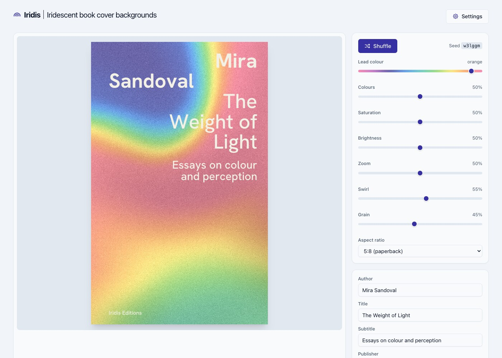
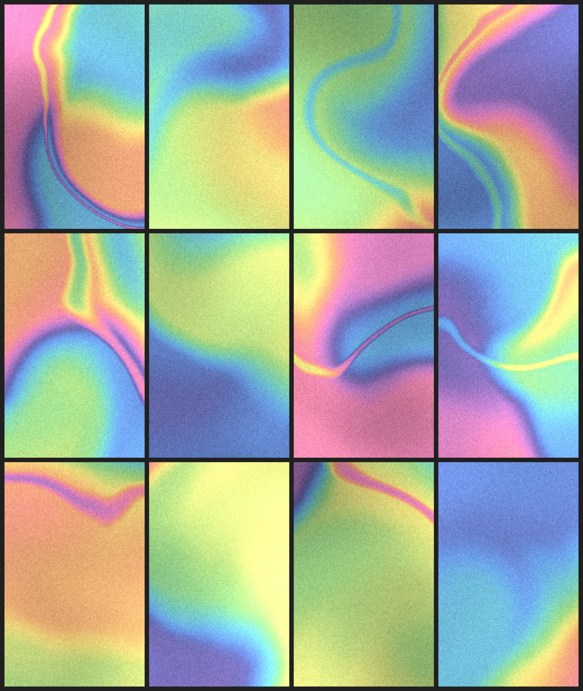

# Iridis

Book cover backgrounds in the style of iridescent, grainy colour gradients, generated in the
browser. Set a few sliders, type the cover texts, export for print. Every cover is reproducible
from its link.

**Live:** [stekhn.github.io/iridis](https://stekhn.github.io/iridis/)

<p>

</p>

<p>

</p>

## Features

- Computed backgrounds: soft colour fields, curved spectral bands, one lead colour, fine grain.
- Eight controls (lead colour, colours, saturation, brightness, zoom, swirl, grain, aspect ratio)
  and a Shuffle button. The layout of the texts follows from the content.
- Author, title, subtitle and publisher set like on the reference covers, in a bundled grotesk.
- The complete state lives in the URL, versioned. The renderer is bit-identical across browsers
  and devices.
- Export as PNG, JPEG, WebP or PDF (real text, embedded font), in screen and print sizes, with or
  without the text, seed in the file name.
- Installable PWA, fully offline after the first visit. No server, no tracking.

## Quick start

Node 22 (see `.nvmrc`).

```bash
npm install
npm run dev        # http://localhost:5173
npm run build      # static site in dist/, served under /iridis/
npm run preview    # http://localhost:4173/iridis/
npm test           # Vitest
npm run lint       # oxlint
npm run samples    # render backgrounds to PNG from Node
```

## How it works

```
URL → state → worker: field → palette → grain → composite → canvas → text on top
```

The engine in `engine/` is framework-free TypeScript and runs in a Web Worker. It uses only
exact arithmetic (no `sin`, `cos`, `pow`), so the same link gives the same pixels everywhere.
Text is measured with width tables from the font files, so line breaks are identical on every
platform and in the PDF.

Details, decisions and the URL scheme: **[docs/ARCHITECTURE.md](docs/ARCHITECTURE.md)**.

## Project structure

```
engine/src/            engine: state codec, renderer stages, text layout, tests
engine/src/renderers/  one folder per renderer version (v1 is frozen on release)
src/                   React app: worker client, hooks, components, export
scripts/               Node tools: sample renders, font metrics, icons
docs/                  architecture notes and README images
```

## Deployment

Pushes to `main` build and deploy to GitHub Pages (`.github/workflows/deploy.yml`). The Vite
`base` is `/iridis/`; set it to `/` for a user site or a custom domain.

## Acknowledgements

[Hanken Grotesk](https://github.com/marcologous/hanken-grotesk) (OFL),
[pdf-lib](https://pdf-lib.js.org/) and [fontkit](https://github.com/foliojs/fontkit),
[Comlink](https://github.com/GoogleChromeLabs/comlink), [Tabler Icons](https://tabler.io/icons),
[vite-plugin-pwa](https://vite-pwa-org.netlify.app/). The photographed covers of the Tre Oci
series were the visual reference.
